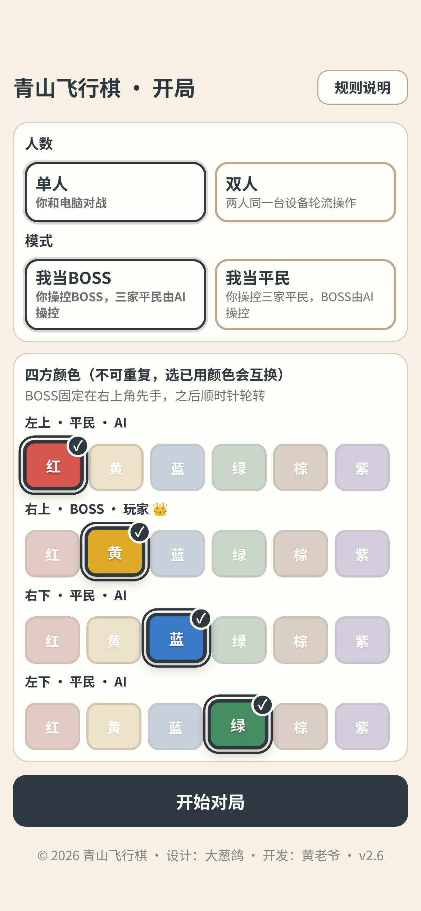
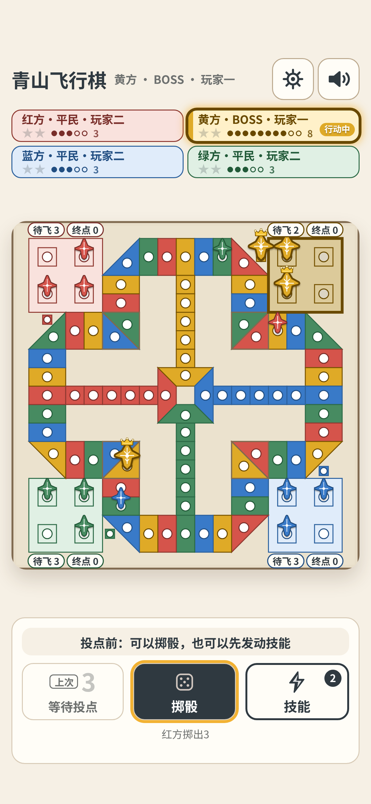

# 青山飞行棋

一款融合六色技能的四人飞行棋网页游戏。一局约十几分钟：当 BOSS 以一敌三，或当平民三色联手；也可以两人在同一台设备上轮流对战。

本仓库只发布可游玩的网页文件，不包含源代码。

## 在线游玩

打开本仓库的 GitHub Pages：**https://asathor007.github.io/qingshan-ludo-game/**

也可下载 [releases/qsludo-v1.0-20261014.html](releases/qsludo-v1.0-20261014.html)，用浏览器直接打开（支持手机、平板与电脑；本地 `file://` 即可，无需联网）。

## 怎么玩

- **阵营**：一方是 BOSS，另外三方是平民。BOSS 开局有 2 架飞机在起飞点，能量上限更高；平民三方互为盟友。
- **胜负**：BOSS 最先让己方 2 架飞机抵达终点即获胜；任意一家平民最先让 2 架飞机抵达终点，平民阵营获胜。
- **回合**：BOSS 先手（固定坐在右上角），之后顺时针轮转。
- **技能**：六种颜色各有 3 个技能，另有 3 个通用技能，用能量发动。
- **模式**：单人（你当 BOSS 或平民，其余由电脑操控）或双人（同一台设备轮流）。

游戏内有完整规则说明与新手引导。电脑快捷键：空格 掷骰 / 连投，S 技能，E 结束，1–9 选格，Esc 取消，M 静音，H 规则。

## 截图

| 开局 | 对局 | 结算 |
|---|---|---|
|  |  |  |

## 版本

详见 [CHANGELOG.md](CHANGELOG.md)。当前正式版：**v1.0**（2026-10-14）。

## 制作

设计：大葱鸽

开发：黄老爷

## 许可

本游戏免费提供，欢迎以非商业目的游玩与分享；禁止任何形式的商业使用，禁止修改后再次发布。

本游戏在AI工具协助下开发完成。
